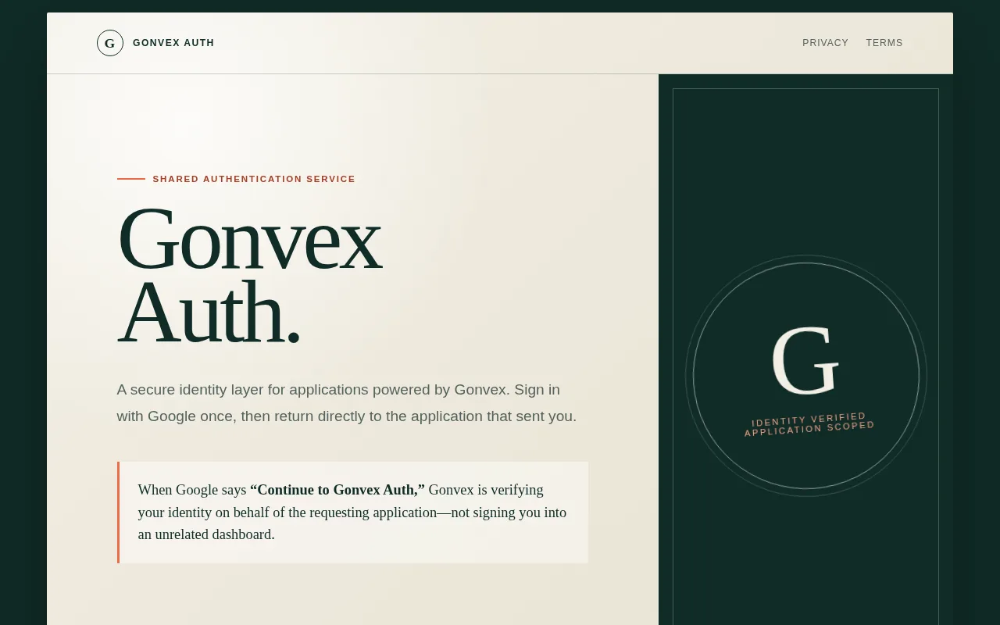
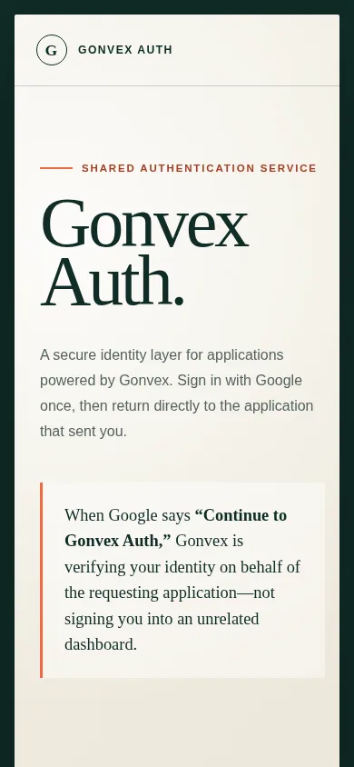

# Gonvex Auth site

The static public site for **Gonvex Auth**, the shared Google sign-in broker used by apps built on [Gonvex](https://github.com/Whagons-International/gonvex). It has an About page, a Privacy Policy and Terms of Service. Google OAuth verification needs those pages, and they explain the "Continue to Gonvex Auth" consent screen to users.

<p>
  
  
</p>

## What's here

| File | Purpose |
| --- | --- |
| `index.html` | About page: what Gonvex Auth is and the three-step sign-in flow |
| `privacy.html` | Privacy policy (served at `/privacy`) |
| `terms.html` | Terms of service (served at `/terms`) |
| `styles.css`, `favicon.svg` | Styling and icon. No JavaScript and no web fonts. |
| `nginx.conf` | Clean URLs for `/privacy` and `/terms`, short caching, and security headers (a strict CSP, `X-Frame-Options: DENY`, `nosniff`, referrer policy) |
| `Dockerfile` | `nginx:1.27-alpine` image with a healthcheck |
| `site.test.mjs` | Node test that checks the pages identify Gonvex Auth and link to each other |

## Run locally

```bash
# test
npm test

# serve with the production nginx config
docker build -t gonvex-auth-site .
docker run --rm -p 8080:80 gonvex-auth-site
# open http://localhost:8080
```

Any static file server also works for a quick look, for example `python3 -m http.server`. Without nginx, the clean `/privacy` and `/terms` URLs won't resolve, so open `privacy.html` and `terms.html` directly.

## Status

This is a small, complete static site with a single commit. The Gonvex runtime and the auth broker are in the separate [gonvex](https://github.com/Whagons-International/gonvex) repository.
